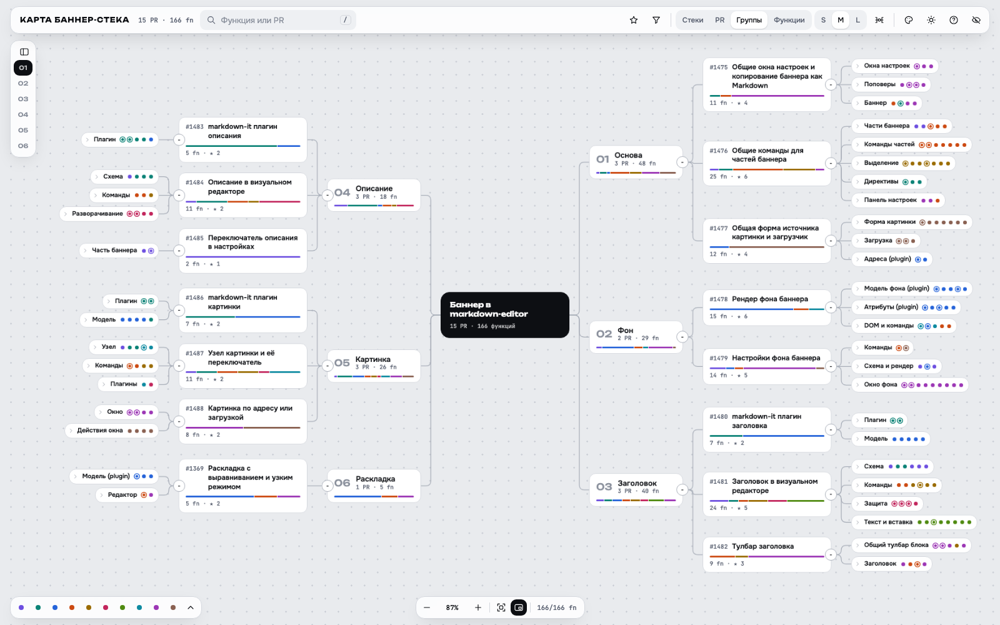
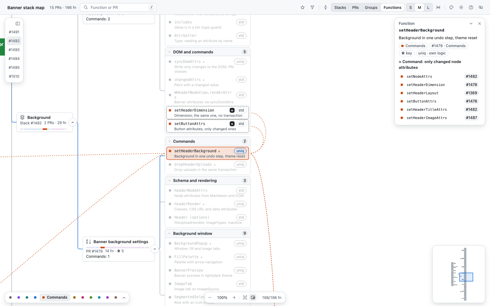
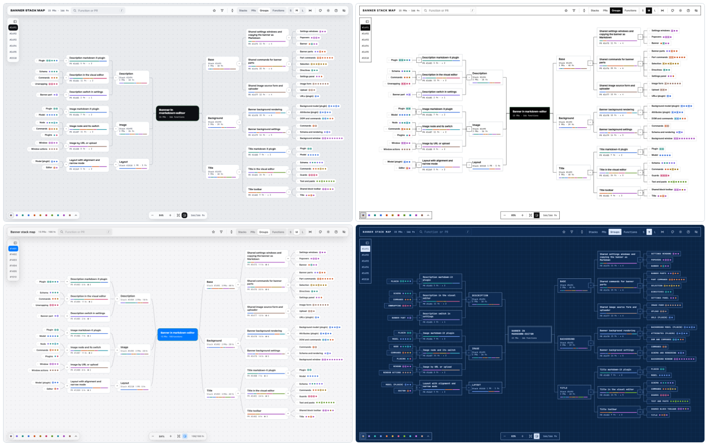

# pr-mindmap

An interactive map of a GitHub pull request or a stack of PRs: stacks → PRs → groups → functions. One HTML page
with no server and no dependencies.



The map shows:

- the essence of the stack and of each PR;
- functions grouped by meaning, each with a short phrase on what it is for;
- on a click on a function: what it is for in plain words, its plugin or extension, whether the product can do
  without it, and the places in the code that use it, each with the PR that added it or the main branch;
- a link to the declaration: the code on the main branch for a function it has already, the PR diff otherwise;
- the type of a function: real logic, a type guard or a small helper; a method shows its owner, `Owner.method`;
- functions the PR only moves: where from and where to, as GitHub shows a renamed file;
- which functions are key (★), which follow a usual pattern and which carry the project's own logic;
- a color for the kind of work (commands, schema, interface…); a click on a color or a function keeps only them bright;
- similar functions from different PRs: the ≈ mark and dashed links.



## Install

Requires Python 3.9+ and [gh](https://cli.github.com) signed in with `gh auth login`.

```sh
git clone https://github.com/makhnatkin/pr-mindmap.git
cd pr-mindmap
./install.sh          # the Claude Code skill and the prmap command in ~/.local/bin
prmap example         # build and open the example
```

Without installing, `./prmap` from the repository folder does the same.

## Make a map

**With a model: the full map.** In Claude Code:

```
/pr-mindmap https://github.com/owner/repo/pull/123
```

The skill collects the stack, reads the diffs, writes the essence of each PR, groups the functions by meaning, assigns
colors and finds similar functions. The result is `map.html`, `map.md` and a published artifact. The map speaks the
language of the request: English, or Russian for a request in Russian.

**Without a model: a draft in a few seconds.**

```sh
prmap new https://github.com/owner/repo/pull/123
```

The draft comes from the diffs alone: stacks from branch names, groups from folders, colors from packages, key
functions are exported ones named in the PR description, similar ones share a name ending. It carries no meaning:
the purpose of a function is its file name. Edit `data.json` by hand or hand it to the skill, then rebuild:

```sh
prmap build prmap-out/owner-repo-123/data.json --open
```

A GitHub stack link (`github.com/<owner>/<repo>/stack/<n>`) gives the PRs of that stack. When a PR is part of a stack, the map gets the whole chain: the PRs below it down to the main branch and the open PRs above it. A stack card links to its GitHub page, a PR card links to the PR. `--no-chain` keeps only the named PRs.

## Commands

| Command | What it does |
| --- | --- |
| `prmap new <PR or stack URL>…` | extract + draft + uses + build: a draft map, opened in the browser |
| `prmap extract <PR or stack URL>… [--out raw.json]` | PR metadata, the stack chain, names from the diffs |
| `prmap draft raw.json [--out data.json]` | a mechanical `data.json` from `raw.json` |
| `prmap uses data.json` | the declaration of each function and the places in the code that call it, at the top of its stack |
| `prmap build data.json [--open]` | `map.html`, `map.artifact.html`, `map.md` next to the data |
| `prmap example` | the example: 15 PRs, 166 functions |
| `prmap dev` | `template.html` with the example data, for editing the template |

`map.html` is a complete document that opens from disk. `map.artifact.html` is the same page without the document
skeleton: the form Claude publishes as an artifact.

## data.json

The full schema is at the top of [build.py](build.py), a working example is [example/banner.json](example/banner.json).

```json
{
  "title": "Banner stack map",
  "lang": "en",
  "root": {"title": "Banner in markdown-editor", "essence": "≤ 150 chars"},
  "cats": [{"id": "cmd", "name": "Commands", "desc": "ProseMirror commands that change the document."}],
  "sims": [{"id": "values", "label": "Values that differ from the defaults", "members": ["fnA", "fnB"]}],
  "stacks": [{
    "name": "Background", "gh": "stack 1492", "essence": "≤ 150 chars",
    "prs": [{
      "n": 1478, "url": "https://github.com/o/r/pull/1478", "branch": "feat/x", "state": "draft",
      "title": "Background rendering", "essence": "≤ 200 chars",
      "groups": [{"name": "Commands", "fns": [
        {"name": "setHeaderBackground", "why": "≤ 50 chars", "key": true, "kind": "u", "cat": "cmd",
         "type": "logic", "ext": "Banner", "about": "≤ 400 chars", "without": "≤ 200 chars",
         "file": "src/background.ts", "line": 12,
         "uses": [{"in": "BannerSettings", "pr": 1480, "url": "https://github.com/o/r/blob/…#L40"}]}
      ]}]
    }]
  }]
}
```

`lang` is the language of the page and of the Markdown list: `en` by default, `ru` for Russian. `kind`: `s` is a
usual pattern, `u` is the project's own logic; `type`: `logic`, `guard` or `util`. Function names are unique across
the map. There are 1 to 10 colors. `about` and `without` explain the function to a reader who does not write code;
`moved: {"from", "to"}` marks a function the PR moves from another file, with `"changed": true` when it changes on
the way.
`prmap uses` fetches the default branch and the PR heads into `~/.cache/pr-mindmap` and fills `file`, `line`, `code`
(a link to the function on the default branch, when it is there) and `uses`: the functions that call it at the top of
its stack, with tests, stories, imports, re-exports and definitions left out; `pr` is the PR that added the place,
`null` the default branch.
The builder checks lengths, color references and similar groups, and writes no files while there are errors.

## Controls

- **Canvas:** pinch or ⌘ + wheel zooms; two fingers or a drag moves; a double click zooms in.
- **Depth:** Stacks / PRs / Groups / Functions (`[` and `]`), the Expand all / Collapse all button (`E`); “−” and “+N” on the edges fold one branch.
- **Density:** S shows names only, M functions with their purpose, L also the essence of stacks and PRs (`D`).
- **Filters:** key functions only (`K`), hide other colors (`F`).
- **Search:** `/`, arrows and Enter.
- **View:** layout to both sides or to one (`L`), theme (`T`), skin (`S`), minimap (`M`), hide the interface (`H`).
- **The selection panel** sits at the right edge over the map; a drag of its header makes it float, the button in the header switches the two modes, a double click on the header docks it again. It changes width by its edge; position and width are remembered.
- `0` fits the whole map, `1` sets 100%, `Esc` clears the selection, `?` shows the hints.

Five skins, each with a light and a dark theme. GitHub is the default: colors and shadows from the Primer tokens,
github.com fonts, counters, labels and cards as in the GitHub interface. The other four:



## Development

```sh
prmap dev                                   # the template with the example data: edit template.html and reload
python3 -m unittest discover -s tests -v    # tests; the browser one runs when Chrome is present, the syntax one when node is
```

- [template.html](template.html) is the whole page: styles, markup and script. A new skin is a block of `-l`/`-d`
  colors and shapes next to the others plus a line in `SKINS`.
- [extract.py](extract.py), [draft.py](draft.py), [uses.py](uses.py), [build.py](build.py) collect, draft, count
  uses and build; `prmap` calls them.
- [SKILL.md](SKILL.md) is the skill for Claude Code.

The page loads its fonts from Google Fonts; offline, system fonts take their place.

## License

[MIT](LICENSE). The GitHub skin embeds icons from [Octicons](https://github.com/primer/octicons) (MIT).
